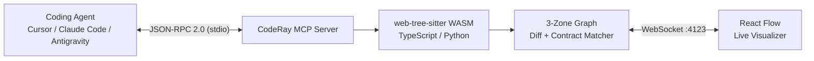
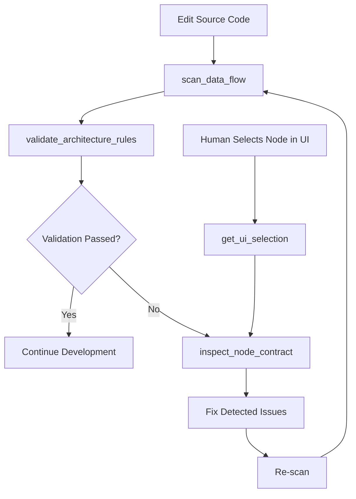

<div align="center">
  <p>
    
  </p>

  <h1>CodeRay MCP</h1>
  <p><strong>Deterministic Code X-Ray for React/Next.js and Python</strong></p>
  <p><em>Understand your code. Trace its data flow. Detect what stays hidden.</em></p>

  <p>
    <a href="#features"><strong>Features</strong></a> ·
    <a href="#quick-start"><strong>Quick Start</strong></a> ·
    <a href="#architecture"><strong>Architecture</strong></a> ·
    <a href="#mcp-tools"><strong>MCP Tools</strong></a> ·
    <a href="#documentation"><strong>Documentation</strong></a>
  </p>

  <p>
    
    
    
    
    
    
  </p>

  <p>Created by <a href="https://github.com/AiRukua">Abdul Wahid Rukua</a></p>
</div>

---

## What is CodeRay?

**CodeRay MCP** is a deterministic code analysis and visualization system that exposes source-code architecture directly to AI coding agents.

Traditional AI code analysis relies heavily on LLM interpretation. CodeRay takes a different approach: it uses **Web Tree-sitter AST parsing** to inspect source code, trace data flow, identify implicit state dependencies, and validate contracts across frontend and backend boundaries.

Every scan is translated into a structured graph with strict architectural swimlanes:

| Zone | Purpose |
| --- | --- |
| 🟢 **`INPUT_GATE`** | Where data enters the system |
| 🔵 **`STATE_MACHINE`** | Where state transitions and mutations occur |
| 🔴 **`IMPLICIT_WARNING`** | Where hidden dependencies and side effects are detected |
| 🟣 **`OUTPUT_GATE`** | Where data leaves the system or produces external effects |

The graph is streamed to a local **React Flow** visualizer, while MCP tools make the analysis accessible to coding agents. CodeRay makes code architecture **observable, traceable, and auditable**.

---

## Features

### 1. Deterministic Polyglot AST
- Powered by `web-tree-sitter` WASM.
- Parses `.ts`, `.tsx`, and `.py` files.
- AST-based structural analysis without LLM guesswork.
- Handles temporarily incomplete syntax during editing.

### 2. Implicit State Leak Detection
Detects hidden dependencies and side effects that are often overlooked during code review:

| Language | Detection |
| --- | --- |
| **TypeScript** | `process.env`, `window.*`, `localStorage.*`, `sessionStorage.*` |
| **TypeScript** | Module-level `let` / `var` mutations |
| **React** | `useEffect` without dependency arrays |
| **Python** | `global` keyword and mutable default arguments (`def fn(a=[])`) |
| **Python** | `os.environ` / `os.getenv` |

### 3. Cross-Boundary Contract Matching
Traces frontend-to-backend communication and validates data contracts:
- Links frontend `fetch()` mutations to backend routes.
- Detects mismatched JSON payload fields.
- Matches Pydantic and Zod schemas.
- Supports FastAPI and Next.js route handlers.

### 4. Graph Diffing & Import Tracing
Compares architectural graphs between scans:
- **`added`** — newly detected nodes or edges.
- **`modified`** — changed graph elements.
- **`removed`** — elements no longer present.
- **1-hop local import tracing** across `.ts`, `.tsx`, and `.py`.

This allows AI coding agents to detect unintended architectural changes instead of silently breaking existing outputs.

### 5. Human-in-the-Loop Visualization
CodeRay provides a local interactive React Flow interface:
- Select individual nodes and edges.
- Inspect architectural relationships and source snippets.
- Add notes directly through the inspector drawer.
- Let coding agents retrieve developer selections through `get_ui_selection`.

### 6. MCP-Native Agent Integration
CodeRay exposes its analysis capabilities directly to supported MCP clients:
- **Cursor**
- **Claude Code**
- **VS Code**
- **Windsurf**
- **Antigravity**

---

## Architecture



### Three-Zone Code Analysis

```text
CODERAY CODE ANALYSIS
┌──────────────────────────────────────────────┐
│                 INPUT_GATE                   │
│                                              │
│        Props · API Routes · Schemas          │
└──────────────────────┬───────────────────────┘
                       │
                       ▼
┌──────────────────────────────────────────────┐
│                STATE_MACHINE                 │
│                                              │
│       State · Mutations · Transitions        │
│                                              │
│     ┌──────────────────────────────────┐     │
│     │         IMPLICIT_WARNING         │     │
│     │                                  │     │
│     │  Hidden Dependencies & Effects   │     │
│     └──────────────────────────────────┘     │
└──────────────────────┬───────────────────────┘
                       │
                       ▼
┌──────────────────────────────────────────────┐
│                 OUTPUT_GATE                  │
│                                              │
│       Returns · Responses · ORM Writes       │
└──────────────────────────────────────────────┘
```

---

## Quick Start

### Requirements
- **Node.js** `>= 20.0.0`
- **pnpm** `>= 10`

### Installation

```bash
pnpm install --config.strict-dep-builds=false
pnpm build
```

### Verify Installation

```bash
pnpm lint && pnpm typecheck && pnpm test
```

### Client Configuration (`.mcp.json`)

```json
{
  "mcpServers": {
    "coderay": {
      "command": "node",
      "args": ["/absolute/path/to/mcp-code-xray/packages/mcp-server/dist/index.js"]
    }
  }
}
```

### Start the MCP Inspector

```bash
npx @modelcontextprotocol/inspector node packages/mcp-server/dist/index.js
```

Once connected, open **`http://localhost:4123`** in your browser.  
The visualizer automatically falls back to ports `4124–4132` if port `4123` is occupied.

---

## MCP Tools

CodeRay provides four tools for code analysis, architecture validation, and human-in-the-loop interaction.

| Tool | Description |
| --- | --- |
| **`scan_data_flow`** | Parses target files via AST, updates the live React Flow canvas, and returns a token-efficient summary, implicit warnings, and optional graph diff. |
| **`inspect_node_contract`** | Returns the exact source snippet, `lineRange`, Zod/Pydantic/TS type contract, and incoming/outgoing edges. |
| **`validate_architecture_rules`** | Audits files for `IMPLICIT_STATE_LEAK` and `CROSS_BOUNDARY_CONTRACT_MISMATCH`. |
| **`get_ui_selection`** | Reads the currently selected node/edge and developer notes from the browser UI. |

### Tool Parameters

- **`scan_data_flow`**
  ```ts
  { filePaths: string[]; includeDiff?: boolean; followLocalImports?: boolean; }
  ```
- **`inspect_node_contract`**
  ```ts
  { nodeId: string; }
  ```
- **`validate_architecture_rules`**
  ```ts
  { filePaths: string[]; strictMode?: boolean; }
  ```
- **`get_ui_selection`**
  ```ts
  {}
  ```

### Recommended Agent Workflow



1. Edit code and call `scan_data_flow` with `includeDiff: true`.
2. Call `validate_architecture_rules` with `strictMode: true`.
3. If the developer selects a node and requests a fix, call `get_ui_selection`.
4. Use `inspect_node_contract` to inspect the selected node.
5. Fix the source code and re-scan.

---

## Detection Matrix

| Zone | TypeScript / React / Next.js | Python / FastAPI |
| --- | --- | --- |
| **`INPUT_GATE`** | Component `props`, Next.js `GET`/`POST`/`PUT`/`PATCH`/`DELETE` Route Handlers, `z.object(...)` | Pydantic `BaseModel`, FastAPI route decorators (`@app.post`, `@router.get`, etc.) |
| **`STATE_MACHINE`** | `useState`, `useReducer`, `useContext`, `useStore`, `useSelector` | `Enum` classes, `match/case`, `self.*` mutations |
| **`IMPLICIT_WARNING`** | `process.env`, `window.*`, `localStorage.*`, `sessionStorage.*`, module-level `let`/`var` mutations, `useEffect` without deps | `global` keyword, mutable default arguments (`def fn(a=[])`), `os.environ` / `os.getenv` |
| **`OUTPUT_GATE`** | JSX `return`, `NextResponse.json`, `Response.json`, `redirect`, `fetch` mutations, ORM writes | `return`, `JSONResponse`, ORM `session.add` / `session.commit` |

---

## Project Structure

```text
mcp-code-xray/
├── packages/
│   ├── shared/          # Zod v4 schemas & TypeScript types
│   ├── mcp-server/      # MCP server + AST + HTTP/WS
│   └── visualizer-ui/   # React 19 + Vite + Tailwind + React Flow
├── .github/workflows/   # CI pipeline
└── .husky/              # Pre-commit hooks
```

---

## Development & Quality Checks

| Command | Purpose |
| --- | --- |
| `pnpm lint` | Oxlint with `--deny-warnings` |
| `pnpm typecheck` | Strict TypeScript checks across packages |
| `pnpm build` | Builds `shared`, `visualizer-ui`, and `mcp-server` |
| `pnpm test` | BDD + Chaos Engineering test suite (Vitest) |

---

## Tech Stack

<div align="center">

| Component | Technology |
| --- | --- |
| **Language** | TypeScript, Python |
| **AST Engine** | `web-tree-sitter` WASM |
| **MCP** | `@modelcontextprotocol/server` |
| **Validation** | Zod v4 |
| **Frontend** | React 19, Vite |
| **Visualization** | `@xyflow/react` |
| **Graph Layout** | `@dagrejs/dagre` |
| **Styling** | Tailwind CSS |
| **Testing** | Vitest |
| **Linting** | Oxlint |

</div>

---

## Documentation

- [Contributing Guide](./CONTRIBUTING.md)
- [Code of Conduct](./CODE_OF_CONDUCT.md)
- [MIT License](./LICENSE)

---

<div align="center">
  <p><strong>CodeRay MCP</strong></p>
  <p><em>See the structure. Trace the flow. Find the hidden state.</em></p>
  <p>Built by <a href="https://github.com/AiRukua">Abdul Wahid Rukua</a></p>
  <p>
    <a href="https://github.com/AiRukua">GitHub Profile</a> ·
    <a href="./CONTRIBUTING.md">Contributing</a> ·
    <a href="./LICENSE">MIT License</a>
  </p>
</div>
