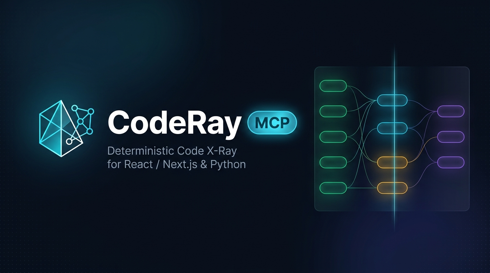
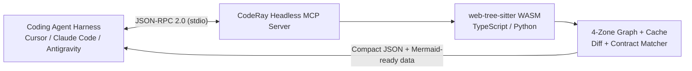
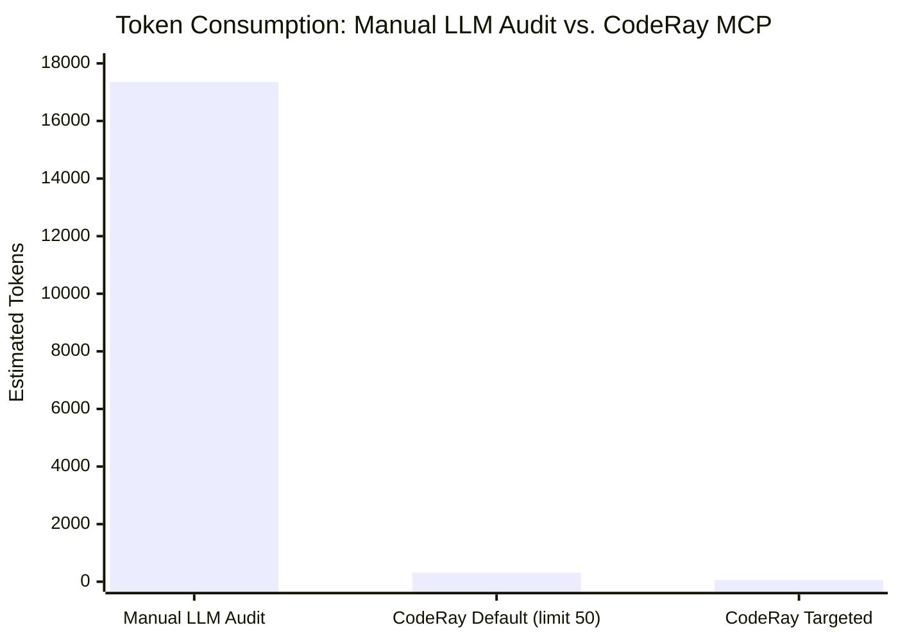

<div align="center">
  <p>
    
  </p>

  <h1>CodeRay MCP</h1>
  <p><strong>Deterministic Code X-Ray for React/Next.js and Python</strong></p>
  <p><em>Understand your code. Trace its data flow. Detect what stays hidden.</em></p>

  <p>
    <a href="#features"><strong>Features</strong></a> ·
    <a href="#quick-start"><strong>Quick Start</strong></a> ·
    <a href="#architecture"><strong>Architecture</strong></a> ·
    <a href="#mcp-tools"><strong>MCP Tools</strong></a> ·
    <a href="#documentation"><strong>Documentation</strong></a>
  </p>

  <p>
    <a href="https://github.com/Airukua/CodeRay/actions/workflows/ci.yml"></a>
    <a href="https://github.com/Airukua/CodeRay/actions/workflows/security.yml"></a>
    <a href="https://github.com/Airukua/CodeRay/blob/main/LICENSE"></a>
    
    = 20">
    
    
    
  </p>

  <p>Created by <a href="https://github.com/AiRukua">Abdul Wahid Rukua</a></p>
</div>

---

## What is CodeRay?

**CodeRay MCP** is a fast, headless, deterministic AST analysis server that exposes source-code architecture directly to AI coding agents via MCP (`stdio`).

Traditional AI code analysis relies heavily on LLM guesswork and burns tokens reading entire files. CodeRay uses **Web Tree-sitter WASM AST parsing** to inspect TypeScript, React/Next.js, and Python code, trace data flow, detect implicit state leaks, and validate cross-boundary contracts—returning compact, targeted JSON so your agent harness can reason or render Mermaid diagrams directly.

Every scan maps code into four architectural zones:

| Zone | Purpose |
| --- | --- |
| 🟢 **`INPUT_GATE`** | Where data enters the system |
| 🔵 **`STATE_MACHINE`** | Where state transitions and mutations occur |
| 🔴 **`IMPLICIT_WARNING`** | Where hidden dependencies and side effects are detected |
| 🟣 **`OUTPUT_GATE`** | Where data leaves the system or produces external effects |

CodeRay makes code architecture **observable, traceable, and auditable** without token bloat or external UI dependencies.

---

## Features

### 1. Deterministic Polyglot AST
- Powered by `web-tree-sitter` WASM.
- Parses `.ts`, `.tsx`, and `.py` files.
- AST-based structural analysis without LLM guesswork.
- Handles temporarily incomplete syntax during editing.

### 2. Implicit State Leak Detection
Detects hidden dependencies and side effects that are often overlooked during code review:

| Language | Detection |
| --- | --- |
| **TypeScript** | `process.env`, `window.*`, `localStorage.*`, `sessionStorage.*` |
| **TypeScript** | Module-level `let` / `var` mutations |
| **React** | `useEffect` without dependency arrays |
| **Python** | `global` keyword and mutable default arguments (`def fn(a=[])`) |
| **Python** | `os.environ` / `os.getenv` |

### 3. Cross-Boundary Contract Matching
Traces frontend-to-backend communication and validates data contracts:
- Links frontend `fetch()` mutations to backend routes.
- Detects mismatched JSON payload fields.
- Matches Pydantic and Zod schemas.
- Supports FastAPI and Next.js route handlers.

### 4. Graph Diffing & Import Tracing
Compares architectural graphs between scans:
- **`added`** — newly detected nodes or edges.
- **`modified`** — changed graph elements.
- **`removed`** — elements no longer present.
- **1-hop local import tracing** across `.ts`, `.tsx`, and `.py`.

This allows AI coding agents to detect unintended architectural changes instead of silently breaking existing outputs.

### 5. Targeted & Token-Efficient AST Queries
Designed for real-world agent harnesses:
- **Category filtering** (`categories: ["INPUT_GATE", "IMPLICIT_WARNING"]`) to query only what matters.
- **Output capping** (`limit`, default `50`) to prevent context-window bloat while keeping the full graph cached for `inspect_node_contract`.
- **Recursive directory scanning** with `projectRoot` support and symlink/size-cap sandboxing (`1 MiB` per file, `500` files max).

### 6. MCP-Native Agent Integration
CodeRay exposes its analysis capabilities directly to supported MCP clients:
- **Cursor**
- **Claude Code**
- **VS Code**
- **Windsurf**
- **Antigravity**

---

## Architecture



### Three-Zone Code Analysis

```text
CODERAY CODE ANALYSIS
┌──────────────────────────────────────────────┐
│                 INPUT_GATE                   │
│                                              │
│        Props · API Routes · Schemas          │
└──────────────────────┬───────────────────────┘
                       │
                       ▼
┌──────────────────────────────────────────────┐
│                STATE_MACHINE                 │
│                                              │
│       State · Mutations · Transitions        │
│                                              │
│     ┌──────────────────────────────────┐     │
│     │         IMPLICIT_WARNING         │     │
│     │                                  │     │
│     │  Hidden Dependencies & Effects   │     │
│     └──────────────────────────────────┘     │
└──────────────────────┬───────────────────────┘
                       │
                       ▼
┌──────────────────────────────────────────────┐
│                 OUTPUT_GATE                  │
│                                              │
│       Returns · Responses · ORM Writes       │
└──────────────────────────────────────────────┘
```

---

## Quick Start

### Requirements
- **Node.js** `>= 20.0.0`
- **pnpm** `>= 10`

### Installation

```bash
pnpm install --config.strict-dep-builds=false
pnpm build
```

### Verify Installation

```bash
pnpm lint && pnpm typecheck && pnpm test
```

### Client Configuration (`.mcp.json`)

```json
{
  "mcpServers": {
    "coderay": {
      "command": "node",
      "args": ["/absolute/path/to/mcp-code-xray/packages/mcp-server/dist/index.js"]
    }
  }
}
```

### Start the MCP Inspector

```bash
npx @modelcontextprotocol/inspector node packages/mcp-server/dist/index.js
```

---

## MCP Tools

CodeRay provides four focused, headless tools for AST scanning, contract inspection, architecture validation, and AI drift verification.

| Tool | Description |
| --- | --- |
| **`scan_data_flow`** | Parses target files or directories via AST and returns a compact, token-efficient summary (`counts`, `implicitWarnings`, filtered `nodeIds` with `inputFormat`/`outputFormat`/`contract`, and optional `diff`). |
| **`inspect_node_contract`** | Returns the exact source snippet, `lineRange`, Zod/Pydantic/TS type contract, and incoming/outgoing edges for a cached node. |
| **`validate_architecture_rules`** | Audits files/directories for `IMPLICIT_STATE_LEAK` and `CROSS_BOUNDARY_CONTRACT_MISMATCH` (supports `strictMode`). |
| **`check_architecture_drift`** | Compares Git baseline AST (`baseRef`, default `HEAD`) vs working-tree AST across TypeScript and Python to detect new implicit leaks, removed input gates, contract drift, AI-slop complexity/type-bypasses, and test-tampering—returning a `GREEN`/`YELLOW`/`RED` risk tier and `passed` oracle. |

### Tool Parameters

- **`scan_data_flow`**
  ```ts
  {
    filePaths: string[];
    projectRoot?: string;
    categories?: ("INPUT_GATE" | "STATE_MACHINE" | "IMPLICIT_WARNING" | "OUTPUT_GATE")[];
    limit?: number; // default 50
    includeDiff?: boolean;
    followLocalImports?: boolean;
  }
  ```
- **`inspect_node_contract`**
  ```ts
  { nodeId: string; }
  ```
- **`validate_architecture_rules`**
  ```ts
  { filePaths: string[]; projectRoot?: string; strictMode?: boolean; }
  ```
- **`check_architecture_drift`**
  ```ts
  { projectRoot?: string; baseRef?: string; filePaths?: string[]; strictMode?: boolean; }
  ```

### Recommended Agent Workflow

```mermaid
flowchart TD
    A["AI Edits Code"] --> B["check_architecture_drift (baseRef: HEAD)"]
    B --> C{"passed === true (GREEN/YELLOW)?"}
    C -->|Yes| D["Ready for Human Review"]
    C -->|No (RED)| E["inspect_node_contract / Fix Leaks & Tampering"]
    E --> F["Re-run check_architecture_drift"]
    F --> C
```

1. For full codebase mapping, call `scan_data_flow` on targeted production directories/files (using `categories` and `limit` to minimize tokens).
2. After an AI coding agent edits files, call `check_architecture_drift` (with `strictMode: true`) as a deterministic Stop Hook / CI gate to catch new implicit leaks, removed input gates, AI-slop type bypasses, or test tampering.
3. Use `inspect_node_contract` on flagged warnings or key nodes to inspect exact snippets and contracts.
4. Fix issues and re-run `check_architecture_drift` until `passed: true`.

---

## Token Efficiency Benchmark

Live A/B comparison auditing **15 production TypeScript files** in `packages/mcp-server/src` for Input Gates, State Containers, and Implicit State Leaks (`ceil(chars / 4)` token approximation):



| Metric | Manual LLM Audit (No CodeRay) | CodeRay MCP (Targeted) | Efficiency Gain |
| --- | ---: | ---: | ---: |
| **LLM Turns** | `6` turns | `1` turn | **`6×` fewer turns** |
| **Tool Calls** | `17` calls (`find` + `read_file`) | `2` calls (`scan_data_flow` + `validate_architecture_rules`) | **`8.5×` fewer calls** |
| **Tool Output Characters** | `69,344` chars | `236` chars | **`99.66%` smaller** |
| **Estimated Tokens (excl. thinking)** | `~17,355` tokens | `~59` tokens | **`~294×` token savings** |
| **Estimated Tokens (incl. thinking)** | `~17,660` tokens | `~59` tokens | **`~299×` token savings** |

> **Recommended Pattern:** Use CodeRay as a deterministic **first-pass triage** (`~59–312` tokens) to map boundaries and catch standard implicit leaks (`process.env`, `global`, `os.environ`, module `let`/`var` mutations), then inspect only the targeted files/nodes when deeper semantic auditing (such as `const` object container mutations or ambient clock usage) is needed.

---

## Detection Matrix

| Zone | TypeScript / React / Next.js | Python / FastAPI |
| --- | --- | --- |
| **`INPUT_GATE`** | Component `props`, Next.js `GET`/`POST`/`PUT`/`PATCH`/`DELETE` Route Handlers, `z.object(...)` | Pydantic `BaseModel`, FastAPI route decorators (`@app.post`, `@router.get`, etc.) |
| **`STATE_MACHINE`** | `useState`, `useReducer`, `useContext`, `useStore`, `useSelector` | `Enum` classes, `match/case`, `self.*` mutations |
| **`IMPLICIT_WARNING`** | `process.env`, `window.*`, `localStorage.*`, `sessionStorage.*`, module-level `let`/`var` mutations, `useEffect` without deps | `global` keyword, mutable default arguments (`def fn(a=[])`), `os.environ` / `os.getenv` |
| **`OUTPUT_GATE`** | JSX `return`, `NextResponse.json`, `Response.json`, `redirect`, `fetch` mutations, ORM writes | `return`, `JSONResponse`, ORM `session.add` / `session.commit` |

---

## Project Structure

```text
mcp-code-xray/
├── .agents/skills/coderay-xray/  # Agent harness exclusion & X-Ray skill
├── packages/
│   ├── shared/                   # Zod v4 schemas & TypeScript types
│   └── mcp-server/               # Headless MCP server + Tree-sitter AST + OWASP tests
├── .github/workflows/            # CI & OWASP security pipelines
└── .husky/                       # Pre-commit hooks
```

---

## Development & Quality Checks

| Command | Purpose |
| --- | --- |
| `pnpm lint` | Oxlint with `--deny-warnings` |
| `pnpm typecheck` | Strict TypeScript checks across packages |
| `pnpm build` | Builds `shared` and `mcp-server` |
| `pnpm test` | BDD + OWASP Security + Chaos test suite (Vitest) |
| `pnpm audit --prod --audit-level=high` | Dependency vulnerability audit |

---

## Tech Stack

<div align="center">

| Component | Technology |
| --- | --- |
| **Language** | TypeScript, Python |
| **AST Engine** | `web-tree-sitter` WASM |
| **MCP** | `@modelcontextprotocol/server` (stdio) |
| **Validation** | Zod v4 |
| **Testing** | Vitest |
| **Linting** | Oxlint |
| **Security** | CodeQL, Semgrep (OWASP Top 10), Gitleaks |

</div>

---

## Documentation

- [Contributing Guide](./CONTRIBUTING.md)
- [Code of Conduct](./CODE_OF_CONDUCT.md)
- [MIT License](./LICENSE)

---

<div align="center">
  <p><strong>CodeRay MCP</strong></p>
  <p><em>See the structure. Trace the flow. Find the hidden state.</em></p>
  <p>Built by <a href="https://github.com/AiRukua">Abdul Wahid Rukua</a></p>
  <p>
    <a href="https://github.com/AiRukua">GitHub Profile</a> ·
    <a href="./CONTRIBUTING.md">Contributing</a> ·
    <a href="./LICENSE">MIT License</a>
  </p>
</div>
